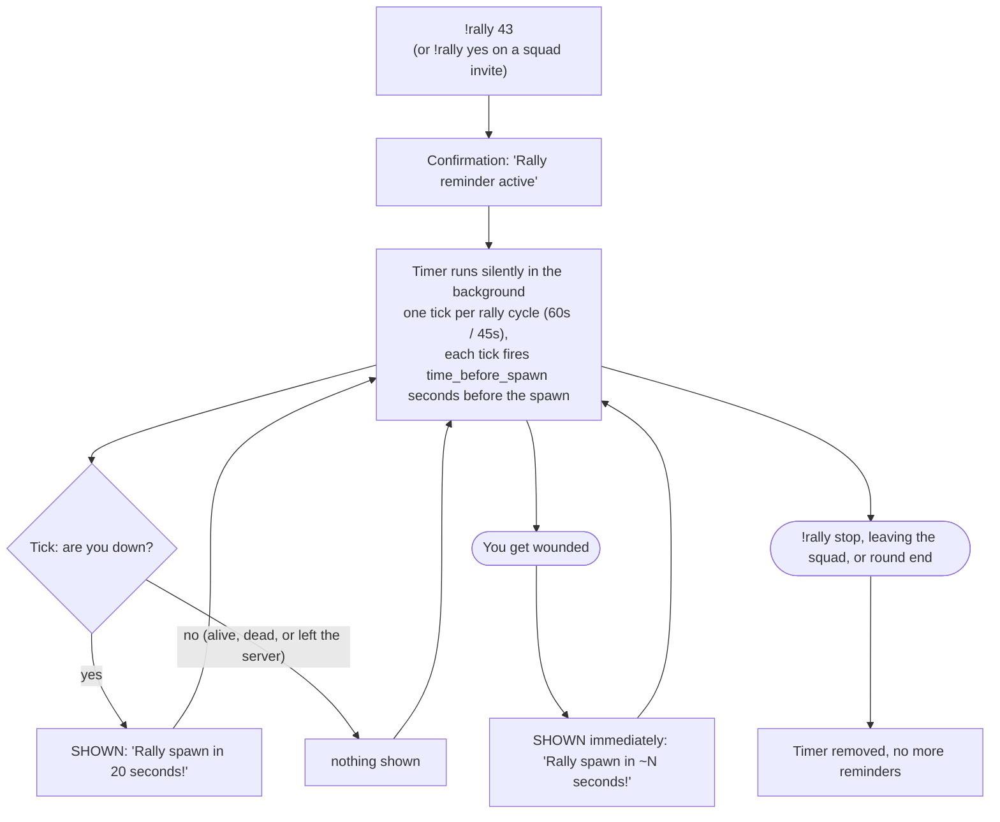

# SquadJS-Timer-Plugins
Forked from https://github.com/ar1ocker/SquadJS-Timer-Plugins

Plugins for SquadJS that allow you to set various timers with reminders.

# timer.js

A plugin that counts down a specified time and reminds you of the timer with a message you enter. Reminds with warms

For example, `!timer mbt 30` - the plugin will remind you about the MBT spawn in 30 minutes.

# rally-timer.js

A plugin that reminds you about the next rally wave shortly before it starts (so you have time to press give up). The reminder is **only sent while you are down** (wounded but not yet dead) — that is the only moment the info is useful. While you are alive it stays silent.

You enter the time your rally is currently showing, e.g. if there are 43 seconds until the wave: `!rally 43`. You have to be in a squad to start a timer (a rally belongs to a squad); otherwise the answer is `You must be in a squad to start a rally timer.`

> Note: Squad exposes no real rally/spawn timer to the server, so the countdown is an **estimate** modeled from the number you enter and a fixed cycle length (see `rally_interval_seconds`).

## Flow: when the reminder is shown



Example with the defaults (`time_before_spawn` 20, 60s cycle): `!rally 43` puts the first tick 23 seconds later (20s before the spawn), then one tick every 60 seconds. If the entered time is not greater than the lead time (e.g. `!rally 15`), the first tick is aimed at the following wave.

### How "down" is detected and reset

Squad has no "is this player down?" query, so the plugin keeps its own list of downed players, built from the server log events SquadJS emits. The list is kept for **every** player on the server, whether or not they have a timer.

| Event | Effect on the down state |
|---|---|
| `PLAYER_WOUNDED` (victim; Squad logs this when a player is incapacitated, not on mere damage) | marked as down |
| `TEAMKILL` (victim) | marked as down |
| `PLAYER_REVIVED` (victim) | reset: no longer down |
| `PLAYER_DIED` (victim: bled out, gave up, or killed while down) | reset: no longer down |
| `UPDATED_PLAYER_INFORMATION` (SquadJS' periodic player list refresh) | reset for everyone who is no longer on the server |
| `ROUND_ENDED` | reset for all players |

The down state is **not** touched by `!rally stop` or by starting a timer, and it lives only in memory: after a SquadJS restart (or plugin reload) everybody counts as not down until they are wounded again.

### Squad rally

`!rally 30 sq` behaves differently depending on who types it:

- **Squad leader:** the timer starts immediately for every member of the squad, synced to the leader's cycle, without any confirmation. Each member is told who started it and how to get out: `<leader> started a squad rally timer for you (20s before spawn).` / `Reminders only appear while you're down.` / `Stop with: !rally stop` / `No squad timers: !rally optout`. A timer the member already had is replaced.
- **Regular squad member:** the other members only get an invitation and join with `!rally yes`.

`!rally optout` excludes you from both until SquadJS restarts and stops a reminder that is already running. Players who join the squad later are not added automatically; the leader repeats the command. Squad leader status comes from SquadJS' player list, which refreshes every 30 seconds, so a freshly promoted leader may still be treated as a regular member for a moment.

### Asking for the spawn time by command

`!rally` without arguments answers in **any** state (alive, down, dead): `Next rally spawn in ~N seconds.` It is the only way to see the time while you are not down.

- It needs a running timer of your own (started with `!rally <seconds>` or joined with `!rally yes`). Without one the answer is `You don't have an active rally timer. Start one with: !rally <seconds>`; there is no server-wide rally time to fall back on.
- The value is the plugin's estimate, not Squad's real timer: it is re-anchored on every tick, and once a modeled spawn has passed it counts towards the next one by whole cycles.

| Situation | Message |
|---|---|
| Timer running, you are alive | none |
| You get wounded while a timer is running | immediately: `Rally spawn in ~N seconds!` |
| Tick while you are still down | `Rally spawn in 20 seconds!`, repeated every cycle for as long as you stay down |
| Tick after you were revived, died / gave up, or left | none (the timer keeps running silently) |
| You get wounded without a running timer | none |
| You start a timer while already down | only the confirmation; the reminder comes with the next tick |
| `!rally` (no arguments) | always answered, in any state: `Next rally spawn in ~N seconds.` |
| `!rally stop` | reminders end, confirmed with a message |
| Round ends | all timers and pending squad invitations are dropped, without a message |

A timer survives deaths and respawns. It ends with `!rally stop`, `!rally optout`, the end of the round, or when you **leave or switch your squad** (or change team): a rally belongs to a squad, so the timer and any pending invitation are dropped and you get `You left your squad. Rally reminders stopped.` SquadJS notices squad changes with its player list refresh, so this can take up to 30 seconds.

The rest of the details are in the script, it's simple, and the script installation is standard.

## Usage

For a timer: `!timer <message> <time in minutes>` (e.g., `!timer mbt 30`)

Everything else is one command, `!rally`:

| Command | What it does |
|---|---|
| `!rally 30` | Start a reminder (`30` = seconds your rally currently shows) |
| `!rally 30 25` | Start with a custom reminder lead time (warn `25`s before spawn) |
| `!rally 30 sq` (or `!rally 30 squad`) | Start a squad-wide rally. As **squad leader**: the timer starts directly for every squad member, no confirmation needed. As a regular member: every squad member gets an invitation |
| `!rally yes` | Accept a pending squad rally invitation |
| `!rally optout` | Opt out (until server restart) of squad rally timers and invitations; also stops your running reminder |
| `!rally` | Show the estimated time until the next rally spawn |
| `!rally stop` | Stop your rally reminders |

The trigger word is configurable via the `commands` option (default `rally`, `r`, `rly`), so `!r 30`, `!rly 30` etc. work too. The first entry is shown in the in-game help text.

Rally spawn cycle length is auto-detected: 60 seconds on vanilla layers, 45 seconds on SuperMod layers (raw layer id starts with `SU_`). Override it with the `rally_interval_seconds` option.

## Configuration

```jsonc
{
    "plugin": "RallyTimer",
    "enabled": true,
    "commands": {
        "required": false,
        "description": "Chat commands (without the ! prefix) that open the rally menu, e.g. !rally, !r. The first entry is used as the primary command in help/reminder text.",
        "default": ["rally", "r", "rly"]
    },
    "time_before_spawn": {
        "required": false,
        "description": "Default seconds before the modeled spawn at which the reminder fires (overridable per command, e.g. !rally 30 25)",
        "default": 20
    },
    "max_time": {
        "required": false,
        "description": "Maximum accepted rally-time argument, in seconds",
        "default": 120
    },
    "rally_interval_seconds": {
        "required": false,
        "description": "Rally spawn cycle length in seconds. Leave unset to auto-detect (60s vanilla, 45s on SuperMod layers prefixed with SU_).",
        "default": null
    }
},
{
    "plugin": "Timer",
    "enabled": true
}
```
